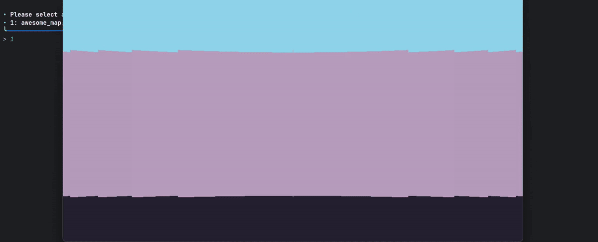
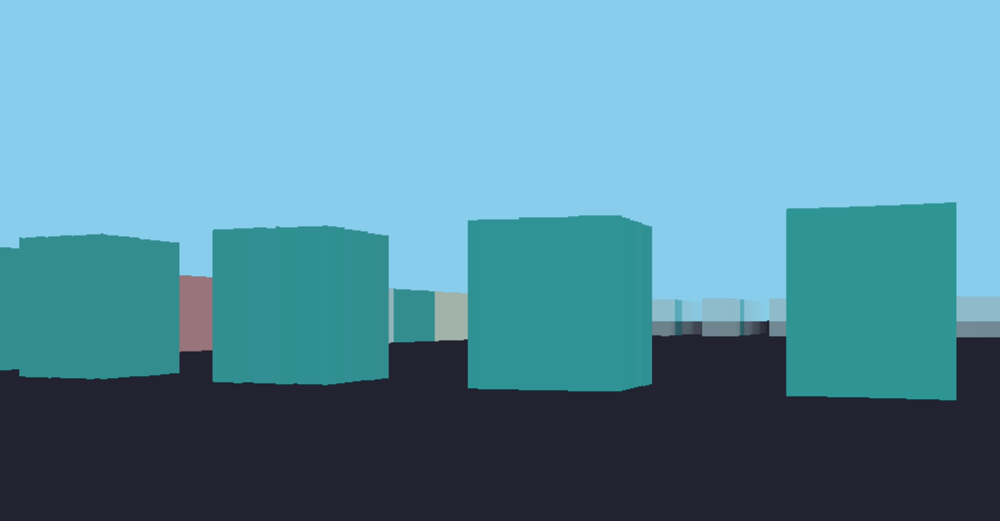
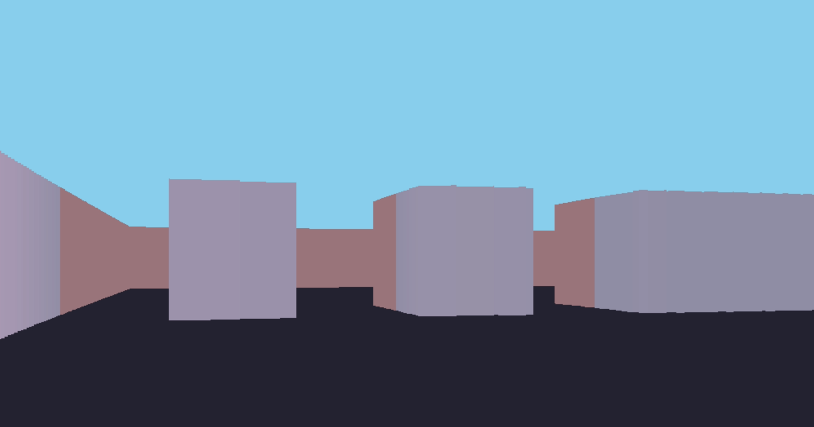

# raycast-engine

Java / JavaFX raycasting with grid maps and sliding collisions.

| Move | Turn | Sprint | Sneak |
| :--: | :--: | :--: | :--: |
| WASD | ← → | Ctrl | Shift |

Java 24+ · JavaFX · bundled `lib/ana.jar` · launch `game.Launcher` from the project root.

Screenshots

